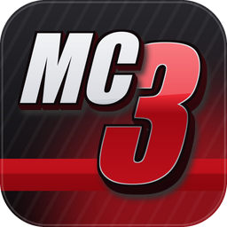
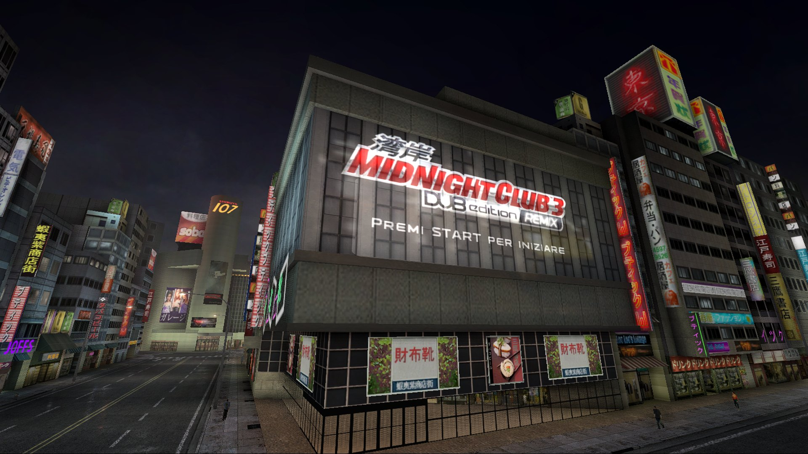
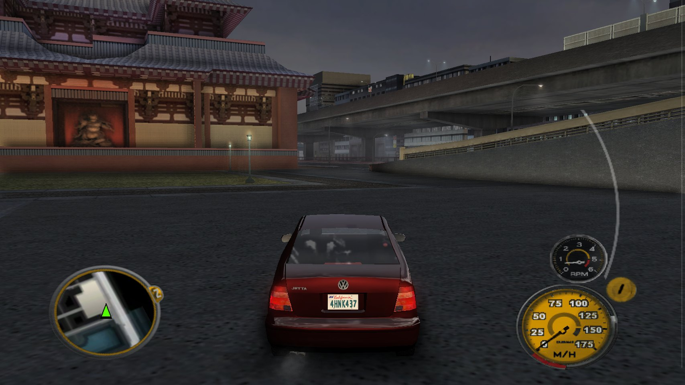
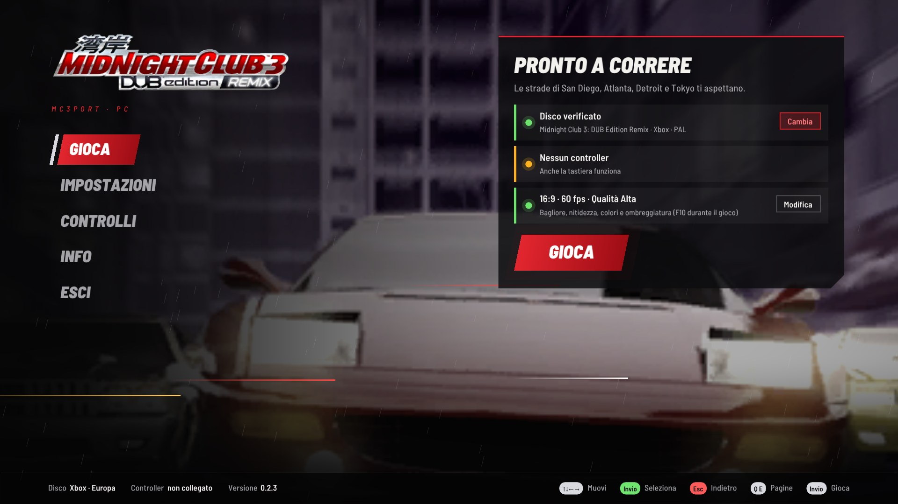
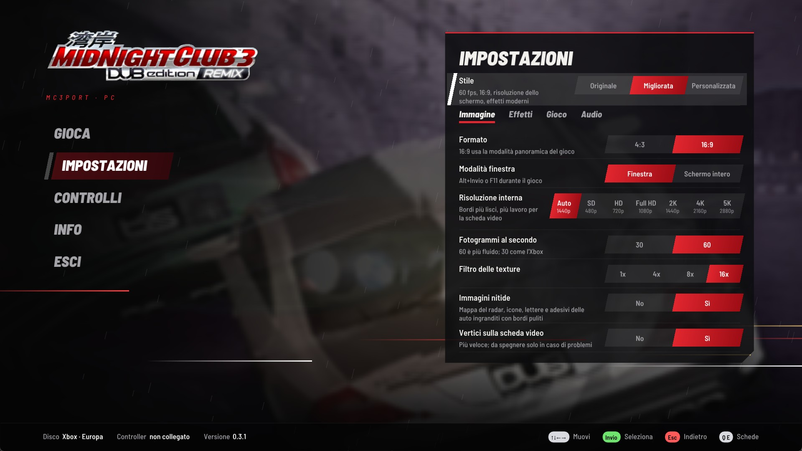
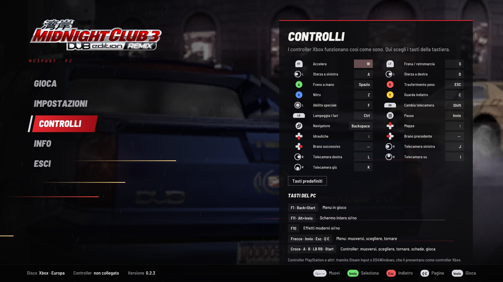

<p align="center"></p>

# mc3port

An unofficial native Windows port of **Midnight Club 3: DUB Edition Remix** for the original Xbox (European release).
It runs the game from **your own disc image**, with 16:9 widescreen, up to 60 fps, a higher internal resolution and
optional modern effects.

> [!IMPORTANT]
> mc3port is an unofficial, non-commercial fan project. It is not affiliated with, endorsed by or sponsored by
> Rockstar Games, Take-Two Interactive or Microsoft. Midnight Club is a trademark of Take-Two Interactive Software.
>
> **No game data is included or distributed**: no disc images, no executables, no textures, sounds, music or films.
> To play you need your own, legally obtained copy of the game. mc3port reads everything it needs from your disc
> image while it runs. Please do not ask for game files or disc images, and do not share them.

## Screenshots



| | |
|---|---|
|  |  |
|  |  |

The launcher speaks English or Italian, following Windows; these captures come from an Italian Windows. Its logo and
pictures are read from the player's disc. The game content in the screenshots belongs to its owners.

## What it is

mc3port is a port, not a remaster. It runs the original 2005 game, with its own cars, cities, physics and soundtrack.
The game's x86 code runs natively on your PC; mc3port replaces the Xbox around it: its kernel, the NV2A graphics chip
(on Direct3D 11), the sound chip (on XAudio2) and the controllers (on XInput).

Compared with the console:

- **True 16:9**: the game's own widescreen mode, with a wider view and no stretching or black bars, and the HUD
  kept in shape: round radar and dials.
- **60 fps**, or 30 like the Xbox.
- **Higher internal resolution** (from the Xbox's 480p up to 4K, or as many lines as your screen) with anisotropic
  filtering, for smooth edges and sharp textures.
- **Modern effects**, all optional: light glow, adaptive sharpening, colour, vignette and ambient occlusion
  (F10 switches them on and off to compare).
- **A launcher** that checks your disc, sets everything up on the first start and holds all the settings.
- **An in-game menu** (F1, or Back+Start on a controller) with the same settings and controls; it pauses the game.
- **A frame counter**, optional, and the opening films skipped (they can be switched back on).
- **Keyboard support** with rebindable keys, and Xbox controllers for up to four players.

## Requirements

- **Windows 10 or 11, 64-bit.** Nothing else to install: the Visual C++ runtime is built in, and Direct3D 11,
  XAudio2 and the shader compiler are part of Windows 10 and 11. Windows **N** editions only: install the Media
  Feature Pack (Settings, Apps, Optional features), or `mc3runtime.dll` will not load.
- **A graphics card and driver with Direct3D 11** (feature level 11_0). The processor counts more than the
  graphics card: see [Performance](#performance).
- **A disc image** (`.iso` or `.cci`) of **Midnight Club 3: DUB Edition Remix, Xbox, Europe (En, Fr, De, Es, It)**.
  XISO and full Redump dumps both work, in one file or split in parts (`name.1.iso`, `name.2.iso`: choose any part),
  and so does the compressed CCI format (`.cci`, also split). Other releases (for example the North American one) are not supported yet:
  mc3port checks the game's executable (`default.xbe`, SHA-256 `29d866afda9c54590a854fdfa98cf6e69d871dd3fc02da20bbbf76c3582c7b09`)
  and tells you if the disc is a different version.
- Optional: an Xbox controller (see [Controls](#controls)); an internet connection, only for the update check (it
  can be switched off in Settings). An audio output device is not required: without one the game runs silent.

## Installing

**With Quiver Launcher**: find mc3port in the catalog and install it. Quiver keeps it up to date.

**With the installer**: download `mc3port-<version>-windows-x86-setup.exe` from the
[releases page](https://github.com/SickSartori/mc3port/releases) and run it. It installs for your user only (no
administrator rights), adds Start menu and desktop shortcuts, and can be removed from Windows' installed apps. When a
new version comes out, the launcher offers to update: it downloads the new installer, checks its SHA-256 and shows it
in Explorer, and you start it.

**Portable**: download `mc3port-<version>-windows-x86.zip` and extract it where you like: it contains a folder
`mc3port`, and `mc3.exe` inside it starts the game. To update, extract the new version in the same place, replacing
the files.

**Linux (Wine)**: download `mc3port-<version>-linux.tar.gz`: see [Linux](#linux-experimental).

All packages contain `README.txt`, a short guide to what you need, the first start and where your files are, and
`CHANGELOG.md`, what changed in each version.

To check a download, compare its SHA-256 with the `SHA256SUMS` file of the release. The files are not code signed,
so Windows SmartScreen may ask once whether you trust them ("More info", then "Run anyway").

Your settings (`mc3port.ini`), saves (`xbox_hdd`), log and shader cache live in `%LOCALAPPDATA%\mc3port`, so updates
and uninstalling never touch them. To keep them next to `mc3.exe` instead (a USB stick, say), create an empty file
named `portable.txt` there.

## Linux (experimental)

mc3port is a Windows program, but it also runs on Linux through **Wine**. This is experimental: it has been tested
on one machine only, with Wine 11 under WSL2 (Windows' Linux subsystem), where the picture is drawn by the processor.
There the whole program works, from the launcher through the opening films to the career's menus, sound included.
**Not tested yet**: the speed with a real Linux graphics driver, Proton and DXVK, controllers, the Steam Deck, the
installer and the update check. Expect problems; if you meet one, please
[open an issue](https://github.com/SickSartori/mc3port/issues) (see [Troubleshooting](#troubleshooting)).

What it takes:

- **A recent Wine with 32-bit support** (tested: Wine 11.0; mc3port is a 32-bit program). On Debian and Ubuntu this means the
  `i386` architecture and the 32-bit OpenGL and Vulkan libraries (`libgl1:i386`, `libegl1:i386`,
  `libvulkan1:i386`); without them Wine has no Direct3D 11 and the game window stays black. The packages from
  [WineHQ](https://gitlab.winehq.org/wine/wine/-/wikis/Download) bring the rest.
- The **Linux package**, `mc3port-<version>-linux.tar.gz`. Extract it and run `sh mc3port/install.sh`: it copies
  mc3port to `~/.local/share/mc3port`, makes a Wine prefix of its own there (without Mono and Gecko), and adds the
  `mc3port` command in `~/.local/bin` and an entry in the applications menu. Run it again to update. Everything,
  settings and saves included, is in that one folder; the script says how to remove it. The log there starts with
  the Wine and Linux versions.
- Or the **portable zip**, by hand: extract it, put your `.iso` in the `mc3port` folder (it is found there without
  asking) or choose it in the launcher, then start it with `wine mc3.exe` from that folder. Your files are then in
  the Wine prefix, `~/.wine/drive_c/users/<you>/AppData/Local/mc3port` (or next to `mc3.exe` with `portable.txt`).
  With Steam, "Add a non-Steam game" pointing at `mc3.exe` starts it through Proton (not tested yet).

## First start

The launcher opens and asks for your disc image. Choose the `.iso` (or `.cci`) file: mc3port checks it and remembers where it is
(if you move the file later, choose it again). Then pick a quality preset, the aspect ratio and the frame rate, and
press **PLAY**. Next time the launcher opens on its main page; **PLAY** (or Enter, or A on a controller) starts the
game.

## Controls

Xbox controllers (Xbox 360, One and Series, or anything XInput) work as on the console, on ports 1 to 4. PlayStation
and other controllers work through Steam Input or DS4Windows, which present them as Xbox controllers.

Without a controller, the keyboard is controller 1. Every key can be changed in the launcher's **Controls** page.

| Key | Xbox controller |
|---|---|
| W / S | right trigger (accelerate) / left trigger (brake, reverse) |
| A / D | left stick (steer) |
| Space / Esc / Z / C | A (handbrake) / B (weight transfer) / X (nitrous) / Y (look back) |
| F | left stick click (special ability: Zone, Agro or Roar) |
| Left Shift / Left Ctrl | Black (change camera) / White (flash headlights) |
| Enter / Backspace | Start (pause) / Back (navigation system) |
| Arrow keys | D-pad (map, hydraulics, music) |
| I / J / K / L | right stick (camera) |

| PC key | Action |
|---|---|
| F1 (controller: Back+Start) | in-game menu: settings, controls, resume, exit; the game pauses meanwhile |
| F11 or Alt+Enter | full screen on and off |
| F10 | modern effects on and off |

In the launcher and the in-game menu:

| Controller | Keyboard | Action |
|---|---|---|
| D-pad or left stick | arrow keys | up and down through the menu; right into the page, left back out |
| A / B | Enter / Esc | select / back |
| LB / RB | Q / E | previous and next tab (Settings) or page |
| Start | | launcher: play; in-game menu: resume |

## Settings

Everything is in the launcher's **Settings** page, in the game's in-game menu (F1), and in `mc3port.ini` (each key
is explained there). Language, frame rate, aspect ratio, resolution, filtering and the HUD apply the next time the
game starts; the others at once. When you change one of the first in the in-game menu, it offers to restart the game
straight away (progress since the last save is lost). The main ones:

| Setting | What it does |
|---|---|
| Game language | English, French, German, Spanish or Italian; by default like Windows |
| Frames per second | 60, or 30 like the Xbox |
| Aspect ratio | 16:9 (the game's widescreen mode) or 4:3 |
| Quality | Original (like the Xbox), Balanced or High: filtering and effects together; the resolution is its own setting |
| Internal resolution | Auto (as many lines as your screen, the default), SD 480p (like the Xbox), HD 720p, Full HD 1080p, 2K 1440p or 4K 2160p |
| Vertices on the graphics card | on by default; switch it off only to troubleshoot |
| Effects style | **Enhanced** (the default): modern glow, sharpening, colour, vignette and ambient occlusion, without the game's speed blur and light streaks. **Original**: the Xbox's picture, speed blur and light streaks included. **Custom**: every value by itself, speed blur and light streaks too |
| Volume | the game's sound, 0 to 100; even at 100 there is room for many sounds at once without distortion |
| Frame counter | frames per second in a corner while playing; off by default |
| HUD | the game's, or mc3port's: speedometer, rev counter, gear and special ability drawn again, sharp at any resolution, in mph or km/h (the radar stays the game's) |
| Sharp HUD pictures | the radar's map, the icons and the letters enlarged with clean edges instead of blurred; on by default |
| Pause in the background | opens the in-game menu (and pauses) when you switch to another window; on by default |
| Skip the opening films | the Rockstar logos and the game's intro, straight to the title screen; on by default |
| `hud_aspect` (ini only) | in 16:9, the HUD keeps its shape (1, the default) or is stretched as on a widescreen TV (0) |

**Replacement pictures**: a PNG or JPG in a folder `textures_replace` next to `mc3port.ini`, named after a 2D
picture's hash (16 hex digits, for example `83E5DF1E4AC28289.png`), is drawn instead of the game's picture, at any
size. `MC3_DUMP_2D=1` saves the HUD's pictures with their hash in the name (see `docs/DEVELOPMENT.md`). mc3port
includes no pictures: the folder does not exist until you make it.

## Performance

The game itself is light; most of the work goes into turning the Xbox's graphics commands into Direct3D 11. The
processor does that, mostly on one thread, while the graphics card has little to do: one fast processor core
matters more than a powerful graphics card. So far mc3port has been tested on few machines: if the game is not
smooth on yours, choose 30 fps, a lower internal resolution, or the **Balanced** or **Original** preset, and please
report how it runs.

The first time each graphics shader is needed it is compiled in the background (meanwhile the processor does that
work); the results are kept in the `shader_cache` folder, so later runs start without hitches.

## Known issues

- Only the European release is supported.
- Online play (Xbox Live) is not available. Split screen works.
- On monitors wider than 16:9 there are thin black bars at the sides (full screen on a 16:9 monitor has none).
- The Xbox sound chip's own effects, such as reverb, are not reproduced (the game loads them, mc3port leaves them
  out): the sound can be drier than on the console.
- Linux (Wine, Proton) is experimental and only partly tested: see [Linux](#linux-experimental).

## Troubleshooting

- **"Cannot load mc3runtime.dll"**: the file must be next to `mc3.exe`. If it is there, the message's error says what
  is missing: on Windows N editions install the Media Feature Pack; an antivirus may also have quarantined the file
  (the SHA-256 in `SHA256SUMS` lets you check it is the original).
- **The program closes at once, or the game crashes**: open the launcher's **About** page and press **Log folder**;
  `mc3port.log` says what happened last.
- **The game is not smooth**: choose 30 fps, a lower internal resolution, or the **Balanced** or **Original** preset,
  in Settings.
- **No sound**: the game uses the output device that is the Windows default when it starts.
- **The sound is quiet**: check Volume in Settings (100 is the loudest), then the Windows volume. The level leaves room
  for the moments when many sounds play at once, in the city, so that they do not distort.
- **The disc is refused**: only the European release is supported; the launcher's message says what it found.
- **The update fails**: download the installer from the [releases page](https://github.com/SickSartori/mc3port/releases)
  and run it; settings and saves are kept.

To report a problem, press **Report a problem** in the launcher's bottom bar (or in the in-game menu's): it opens the
form on GitHub with your version and PC filled in, and the folder with `mc3port.log` to attach. Or open an
[issue](https://github.com/SickSartori/mc3port/issues) yourself with your Windows version, your
graphics card, what you were doing and `mc3port.log` attached (normally in `%LOCALAPPDATA%\mc3port`; the launcher's
**About** page opens the folder). After a crash, also attach `mc3port-crash.dmp` from the same folder. On Linux, also give the distribution, the Wine or Proton version, the graphics
driver (for example Mesa 25.2 or NVIDIA 580) and how you started the game.

## Building from source

Visual Studio 2022 or newer with "Desktop development with C++" (MSVC x86 tools, Windows SDK, CMake tools).
From a Developer PowerShell in the project folder:

```
cmake -S . -B build/pc-x86 -A Win32
cmake --build build/pc-x86 --config Release
```

`tools/package.ps1` builds the release zip, the installer (with [Inno Setup](https://jrsoftware.org/isinfo.php) 6.6 or
newer) and their `SHA256SUMS` in `dist/`. Technical notes, test switches and
debugging tools are in [docs/DEVELOPMENT.md](docs/DEVELOPMENT.md) (in Italian).

## How this was made

mc3port was written with heavy use of AI (Anthropic's Claude), directed and tested by the author on real hardware.
xemu and other open-source Xbox projects were studied as references only; no code was copied from them.

## Credits

- [Dear ImGui](https://github.com/ocornut/imgui) by Omar Cornut, MIT licence: the launcher's interface.
- [Barlow](https://github.com/jpt/barlow) by Jeremy Tribby, SIL Open Font License: the launcher's font.
- The launcher's background music was generated for mc3port with ElevenLabs Music (through Magnific).
- The program icon and logo are mc3port's own (`tools/make_icon.py`), in the spirit of the game's logo.
- The launcher's logo and pictures are the game's own, read from your disc while it runs; they are not part of
  mc3port.

## Licence

mc3port's code is released under the [MIT licence](LICENSE). Third-party parts keep their own licences, listed in
[THIRD_PARTY.md](THIRD_PARTY.md). The game itself, and everything read from your disc, belongs to its owners.
