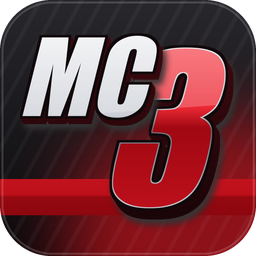
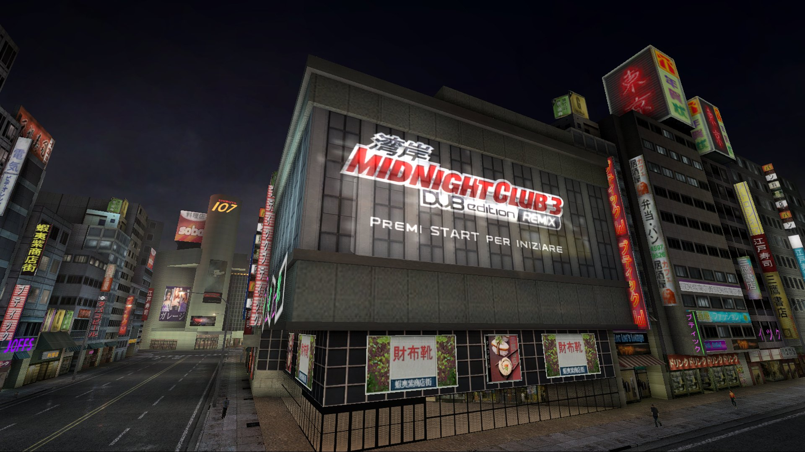
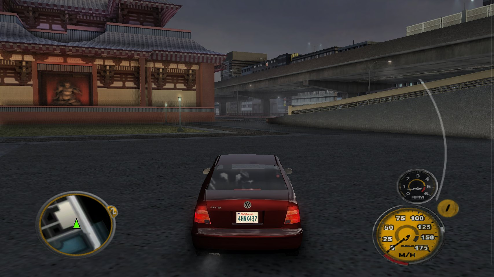
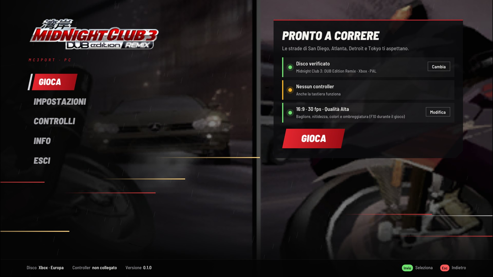
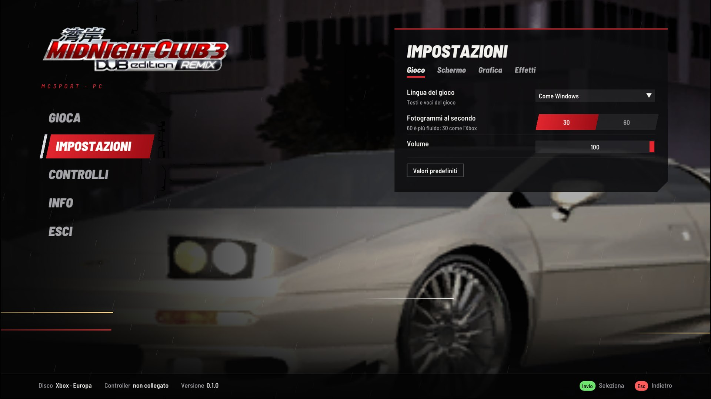
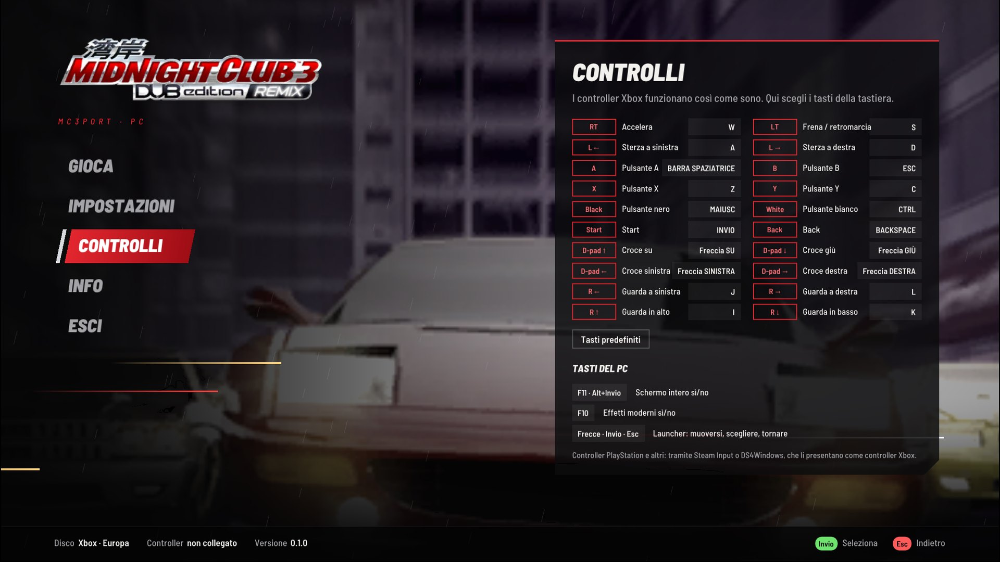

<p align="center"></p>

# mc3port

An unofficial native Windows port of **Midnight Club 3: DUB Edition Remix** for the original Xbox (European release).
It runs the game from **your own disc image**, with 16:9 widescreen, up to 60 fps, a higher internal resolution and
optional modern effects.

> [!IMPORTANT]
> mc3port is an unofficial, non-commercial fan project. It is not affiliated with, endorsed by or sponsored by
> Rockstar Games, Take-Two Interactive or Microsoft. Midnight Club is a trademark of Take-Two Interactive Software.
>
> **No game data is included or distributed**: no disc images, no executables, no textures, sounds, music or films.
> To play you need your own, legally obtained copy of the game. mc3port reads everything it needs from your disc
> image while it runs. Please do not ask for game files or disc images, and do not share them.

## Screenshots



| | |
|---|---|
|  |  |
|  |  |

The launcher speaks English or Italian, following Windows; these captures come from an Italian Windows. Its logo and
pictures are read from the player's disc. The game content in the screenshots belongs to its owners.

## What it is

mc3port is a port, not a remaster. It runs the original 2005 game, with its own cars, cities, physics and soundtrack.
The game's x86 code runs natively on your PC; mc3port replaces the Xbox around it: its kernel, the NV2A graphics chip
(on Direct3D 11), the sound chip (on XAudio2) and the controllers (on XInput).

Compared with the console:

- **True 16:9**: the game's own widescreen mode, with a wider view and no stretching or black bars.
- **60 fps**, or 30 like the Xbox.
- **Higher internal resolution** (up to 4x) with anisotropic filtering, for smooth edges and sharp textures.
- **Modern effects**, all optional: light glow, adaptive sharpening, colour, vignette and ambient occlusion
  (F10 switches them on and off to compare).
- **A launcher** that checks your disc, sets everything up on the first start and holds all the settings.
- **An in-game menu** (F1, or Back+Start on a controller) with the same settings and controls; it pauses the game.
- **A frame counter**, optional.
- **Keyboard support** with rebindable keys, and Xbox controllers for up to four players.

## Requirements

- Windows 10 or 11, 64-bit.
- A graphics card with Direct3D 11.
- A disc image (`.iso`) of **Midnight Club 3: DUB Edition Remix, Xbox, Europe (En, Fr, De, Es, It)**.
  XISO and full Redump dumps both work. Other releases (for example the North American one) are not supported yet:
  mc3port checks the game's executable (`default.xbe`, SHA-256 `29d866afda9c54590a854fdfa98cf6e69d871dd3fc02da20bbbf76c3582c7b09`)
  and tells you if the disc is a different version.

## Installing

**With Quiver Launcher**: find mc3port in the catalog and install it. Quiver keeps it up to date.

**With the installer**: download `mc3port-<version>-windows-x86-setup.exe` from the
[releases page](https://github.com/SickSartori/mc3port/releases) and run it. It installs for your user only (no
administrator rights), adds Start menu and desktop shortcuts, and can be removed from Windows' installed apps. When a
new version comes out, the launcher offers to update: it downloads the new installer, checks its SHA-256 and installs
it, then reopens the game.

**Portable**: download `mc3port-<version>-windows-x86.zip`, extract it into a folder of your choice and start
`mc3.exe`. To update, extract the new version over the old one.

To check a download, compare its SHA-256 with the `SHA256SUMS` file of the release. The files are not code signed,
so Windows SmartScreen may ask once whether you trust them ("More info", then "Run anyway").

Your settings (`mc3port.ini`), saves (`xbox_hdd`), log and shader cache live in `%LOCALAPPDATA%\mc3port`, so updates
and uninstalling never touch them. To keep them next to `mc3.exe` instead (a USB stick, say), create an empty file
named `portable.txt` there.

## First start

The launcher opens and asks for your disc image. Choose the `.iso` file: mc3port checks it and remembers where it is.
Then pick a quality preset, the aspect ratio and the frame rate, and press **PLAY**. Next time the launcher opens on
its main page; **PLAY** (or Enter, or A on a controller) starts the game.

## Controls

Xbox controllers (Xbox 360, One and Series, or anything XInput) work as on the console, on ports 1 to 4. PlayStation
and other controllers work through Steam Input or DS4Windows, which present them as Xbox controllers.

Without a controller, the keyboard is controller 1. Every key can be changed in the launcher's **Controls** page.

| Key | Xbox controller |
|---|---|
| W / S | right trigger (accelerate) / left trigger (brake, reverse) |
| A / D | left stick (steer) |
| Space / Esc / Z / C | A (handbrake) / B (weight transfer) / X (nitrous) / Y (look back) |
| F | left stick click (special ability: Zone, Agro or Roar) |
| Left Shift / Left Ctrl | Black (change camera) / White (flash headlights) |
| Enter / Backspace | Start (pause) / Back (navigation system) |
| Arrow keys | D-pad (map, hydraulics, music) |
| I / J / K / L | right stick (camera) |

| PC key | Action |
|---|---|
| F1 (controller: Back+Start) | in-game menu: settings, controls, resume, exit; the game pauses meanwhile |
| F11 or Alt+Enter | full screen on and off |
| F10 | modern effects on and off |

In the launcher and the in-game menu:

| Controller | Keyboard | Action |
|---|---|---|
| D-pad or left stick | arrow keys | up and down through the menu; right into the page, left back out |
| A / B | Enter / Esc | select / back |
| LB / RB | Q / E | previous and next tab (Settings) or page |
| Start | | launcher: play; in-game menu: resume |

## Settings

Everything is in the launcher's **Settings** page, in the game's in-game menu (F1), and in `mc3port.ini` (each key
is explained there). Language, frame rate, aspect ratio, resolution and filtering apply the next time the game starts;
the others at once. The main ones:

| Setting | What it does |
|---|---|
| Game language | English, French, German, Spanish or Italian; by default like Windows |
| Frames per second | 60, or 30 like the Xbox |
| Aspect ratio | 16:9 (the game's widescreen mode) or 4:3 |
| Quality | Original (like the Xbox), Balanced or High: resolution, filtering and effects together |
| Internal resolution | 1x (640x480) to 4x |
| Modern effects | glow, sharpening, saturation, contrast, vignette, ambient occlusion, each adjustable |
| Vertices on the graphics card | on by default; switch it off only to troubleshoot |
| Motion blur | the game's speed blur: 0 off, 1 as strong as on the Xbox; 0.5 by default |
| Frame counter | frames per second in a corner while playing; off by default |
| Pause in the background | opens the in-game menu (and pauses) when you switch to another window; on by default |

## Performance

The game itself is light; most of the work goes into turning the Xbox's graphics commands into Direct3D 11, much
of it on the graphics card. So far mc3port has been tested on few machines: if the game is not smooth on yours,
choose the **Balanced** or **Original** preset, or 30 fps, and please report how it runs.

The first time each graphics shader is needed it is compiled in the background (meanwhile the processor does that
work); the results are kept in the `shader_cache` folder, so later runs start without hitches.

## Known issues

- Only the European release is supported.
- In 16:9 the game stretches its HUD (radar, speedometer) to the wider screen, as it did on a widescreen TV:
  round dials look slightly oval.
- Online play (Xbox Live) is not available. Split screen works.
- On monitors wider than 16:9 there are thin black bars at the sides (full screen on a 16:9 monitor has none).

## Reporting a problem

Open the launcher's **About** page and press **Log folder**: attach `mc3port.log` from that folder (normally
`%LOCALAPPDATA%\mc3port`) to an
[issue](https://github.com/SickSartori/mc3port/issues), with your Windows version, graphics card and what you were doing.

## Building from source

Visual Studio 2022 or newer with "Desktop development with C++" (MSVC x86 tools, Windows SDK, CMake tools).
From a Developer PowerShell in the project folder:

```
cmake -S . -B build/pc-x86 -A Win32
cmake --build build/pc-x86 --config Release
```

`tools/package.ps1` builds the release zip, the installer (with [Inno Setup](https://jrsoftware.org/isinfo.php) 6.6 or
newer) and their `SHA256SUMS` in `dist/`. Technical notes, test switches and
debugging tools are in [docs/DEVELOPMENT.md](docs/DEVELOPMENT.md) (in Italian).

## How this was made

mc3port was written with heavy use of AI (Anthropic's Claude), directed and tested by the author on real hardware.
xemu and other open-source Xbox projects were studied as references only; no code was copied from them.

## Credits

- [Dear ImGui](https://github.com/ocornut/imgui) by Omar Cornut, MIT licence: the launcher's interface.
- [Barlow](https://github.com/jpt/barlow) by Jeremy Tribby, SIL Open Font License: the launcher's font.
- The launcher's background music was generated for mc3port with ElevenLabs Music (through Magnific).
- The program icon and logo are mc3port's own (`tools/make_icon.py`), in the spirit of the game's logo.
- The launcher's logo and pictures are the game's own, read from your disc while it runs; they are not part of
  mc3port.

## Licence

mc3port's code is released under the [MIT licence](LICENSE). Third-party parts keep their own licences, listed in
[THIRD_PARTY.md](THIRD_PARTY.md). The game itself, and everything read from your disc, belongs to its owners.
